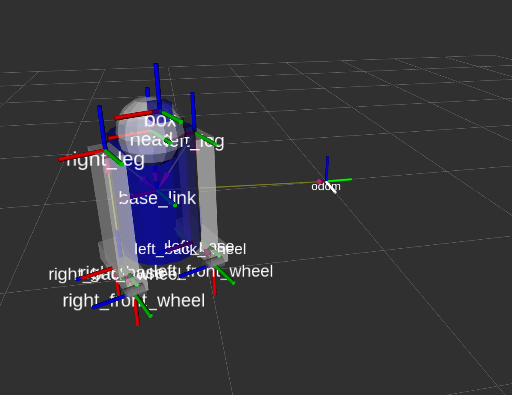

# pybullet_ros

A bridge between [ROS 2](https://docs.ros.org/en/jazzy/) and [PyBullet](https://pybullet.org/wordpress/).



## Project status

This project exposes the pybullet simulator through a ROS 2 node and a set of plugins that implement common robot interfaces:

- Body velocity control – subscribe to `cmd_vel` and apply the desired speed to the robot.
- Joint control – position, velocity and effort control for all revolute joints on the robot.
- Sensors – odometry, joint states, laser scanner and RGB camera image publishers.

Planned features include point cloud support and SDF world loading.

## Installation

The package targets ROS 2 Jazzy on Ubuntu 24.04. The following steps assume you have sourced your ROS 2 environment and created a colcon workspace (`~/ros2_ws` in the example below):

```bash
sudo apt install python3-pip ros-jazzy-xacro ros-jazzy-cv-bridge ros-jazzy-joint-state-publisher-gui
python3 -m pip install --user --upgrade pybullet opencv-python

cd ~/ros2_ws/src
git clone https://github.com/oscar-lima/pybullet_ros.git
cd ..
colcon build --packages-select pybullet_ros
source install/setup.bash
```

## Test the simulator

Two sample robots are provided for testing: **acrobat** and **r2d2**. Their URDF models live under `common/test/urdf`.

### Bring up the r2d2 robot

```bash
ros2 launch pybullet_ros bringup_robot_example.launch.py
```

A pybullet window should appear with the robot loaded. The launch file also starts `robot_state_publisher`, so TF data is available out of the box.

### Send position control commands to the robot

You can command the joints directly by publishing `std_msgs/msg/Float64` messages. For example, to move the head swivel joint:

```bash
ros2 topic pub --once /head_swivel_position_controller/command std_msgs/msg/Float64 "{data: 1.0}"
```

A convenience GUI is also provided:

```bash
ros2 launch pybullet_ros tools/position_cmd_gui.launch.py
```

Use the sliders to command joint angles in position control mode.

### Send velocity or effort control commands

The control plugin exposes velocity and effort interfaces as well:

```bash
ros2 topic pub --once /head_swivel_velocity_controller/command std_msgs/msg/Float64 "{data: 2.0}"
ros2 topic pub --once /head_swivel_effort_controller/command std_msgs/msg/Float64 "{data: -2000.0}"
```

## Visualise the robot in RViz

A ready-to-use configuration file is provided:

```bash
ros2 run rviz2 rviz2 --display-config $(ros2 pkg prefix pybullet_ros)/share/pybullet_ros/config/pybullet_config.rviz
```

## Topics

- `/joint_states` (`sensor_msgs/msg/JointState`) – published at the configured loop rate.
- `/scan` (`sensor_msgs/msg/LaserScan`) – laser scanner readings.
- `/odom` (`nav_msgs/msg/Odometry`) – base odometry.
- `/cmd_vel` (`geometry_msgs/msg/Twist`) – body velocity commands.
- `/rgb_image` (`sensor_msgs/msg/Image`) – RGB camera output.
- `<joint_name>_<type>_controller/command` (`std_msgs/msg/Float64`) – joint control commands (`type` is `position`, `velocity` or `effort`).

## Services

The node provides the following services (all using `std_srvs/srv/Empty`):

```bash
ros2 service call /pybullet_ros/reset_simulation std_srvs/srv/Empty {}
ros2 service call /pybullet_ros/pause_physics std_srvs/srv/Empty {}
ros2 service call /pybullet_ros/unpause_physics std_srvs/srv/Empty {}
```

## Extending with plugins

Plugins are regular Python classes loaded at runtime. See `pybullet_ros/plugins/plugin_template.py` for a minimal example and `config/pybullet_params_example.yaml` for how plugins are configured.
